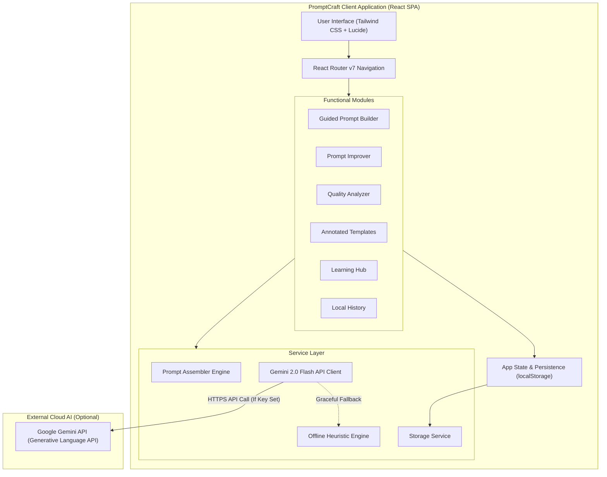

# 🌟 PromptCraft: A Human-Centric Prompt Guidance Interface for Non-Expert Users of Generative AI

[](https://react.dev)
[](https://vitejs.dev)
[](https://tailwindcss.com)
[](https://opensource.org/licenses/MIT)
[](https://acm.org)

> **PromptCraft** is an intelligent, interactive, human-centric web application that empowers non-expert users to communicate effectively with Generative AI systems. Rather than serving as a "black-box" prompt generator, PromptCraft scaffoldingly guides users through effective prompt construction, explains *why* particular prompt structures perform better, and builds long-term AI literacy.

---

## 📑 Table of Contents

- [Overview & Research Motivation](#-overview--research-motivation)
- [Theoretical HCI Foundations](#-theoretical-hci-foundations)
- [Key Features](#-key-features)
- [System Architecture](#-system-architecture)
- [Technology Stack](#-technology-stack)
- [Installation & Getting Started](#-installation--getting-started)
- [Usage Guide](#-usage-guide)
- [Automated Verification & Testing](#-automated-verification--testing)
- [Human-Centered Evaluation Protocol](#-human-centered-evaluation-protocol)
- [Project Documentation Directory](#-project-documentation-directory)
- [Limitations & Future Enhancements](#-limitations--future-enhancements)
- [Academic References](#-academic-references)
- [Authors & Acknowledgments](#-authors--acknowledgments)

---

## 🎯 Overview & Research Motivation

The widespread adoption of Large Language Models (ChatGPT, Claude, Gemini) relies predominantly on open-ended, single-line text inputs. While natural language presents an **illusion of universal accessibility**, human-computer interaction research shows that novice users struggle fundamentally with:

1. **The Blank Page Problem**: Novices do not know how to start or structure complex requests.
2. **Anthropomorphic Misconceptions**: Users talk to models like human colleagues who possess shared implicit context (*Zamfirescu-Pereira et al., CHI 2023*).
3. **Black-Box Automation Traps**: Commercial prompt tools optimize prompts automatically without explaining structural choices, fostering user dependency rather than capability.

**PromptCraft resolves this dilemma by treating prompt construction as an educational craft.** Through visual affordances, signifiers, and progressive disclosure, users construct high-performing prompts while acquiring transferable prompt-engineering knowledge.

---

## 🧠 Theoretical HCI Foundations

| Principle | Author / Standard | Practical Implementation in PromptCraft |
| :--- | :--- | :--- |
| **Affordances & Signifiers** | Donald Norman (*Design of Everyday Things*, 1988/2013) | Form fields provide clear boundaries; helpful placeholders exemplify required inputs; tooltips signal available modifier actions. |
| **Progressive Disclosure** | Jakob Nielsen (1994) | Dual-mode interface: **Quick Mode** (3 core fields) and **Detailed Mode** (full constraints, formatting, and personas). |
| **Zone of Proximal Development** | Lev Vygotsky (1978) | Scaffolded step-by-step guidance that assists novices just beyond their current skill level without overwhelming them. |
| **Gulf of Execution & Evaluation** | Norman, Hutchins & Hollan (1986) | Real-time prompt assembly bridges the Gulf of Execution; multi-dimensional quality scores bridge the Gulf of Evaluation. |
| **Explainable AI (XAI)** | Explainable Prompt Guidance | Every optimization itemizes what was changed, why it helps, and the formal design pattern applied. |

---

## ✨ Key Features

### 1. 🛠️ Guided Prompt Builder
- Domain-specific templates across **Writing, Programming, Education, Research, Creative, Business, and Brainstorming**.
- Dynamic input fields that capture Role, Context, Intent, Length, Tone, and Constraints.
- Real-time prompt preview with live word and character counters.

### 2. ⚡ Intelligent Prompt Improver
- Paste any naive, search-engine-style prompt.
- Dual-engine architecture: uses **Google Gemini 2.0 Flash API** when connected, with instantaneous **offline rule-based heuristic fallback**.
- Itemized change explanations identifying prompt patterns (Persona Pattern, Constraint Pattern, Output Automator).

### 3. 📊 Multi-Dimensional Prompt Quality Analyzer
- Scores prompts on 5 distinct dimensions: **Specificity, Context, Clarity, Structure, and Actionability**.
- Explains quality scores using constructive natural-language feedback rather than arbitrary numbers.

### 4. 📚 Annotated Prompt Templates
- Curated prompt library with customizable `{variable}` placeholders.
- Inline "HCI Insights" explaining why each parameter was included.
- One-click copy or direct export into the Guided Builder.

### 5. 🎓 Interactive Learning Hub
- **Prompt Anatomy**: Interactive breakdown of essential prompt components.
- **Common Mistakes**: Interactive side-by-side comparisons of novice vs. structured prompts.
- **Academic Patterns**: 5 formal patterns from Vanderbilt University (*White et al., 2023*).
- **Quick Rules**: 12 bite-sized rules for everyday prompt writing.

### 6. 🕒 Local History & Persistence
- Automatically saves constructed and improved prompts to browser `localStorage`.
- One-click export to structured JSON.
- Complete privacy: zero tracking or external database storage.

---

## 🏗️ System Architecture



---

## 💻 Technology Stack

| Layer | Technology | Version | Justification |
| :--- | :--- | :--- | :--- |
| **Frontend Framework** | React | 19.3 | Component-driven architecture, instant virtual DOM diffing |
| **Build Tool** | Vite | 8.3 | Sub-second HMR, optimized production tree-shaking |
| **Styling** | Tailwind CSS | 4.3 | Utility-first, zero runtime CSS overhead, accessible color contrast |
| **Icons** | Lucide React | 1.70 | Clean, modern, accessible SVG iconography |
| **Routing** | React Router | 7.18 | Client-side SPA navigation with history management |
| **State & Storage** | React Context + Web Storage | HTML5 | Zero-latency local persistence with no database setup required |
| **AI Integration** | Google Gemini 2.0 Flash | REST | Generous free tier, rapid generation latency |
| **Offline Fallback** | Custom Rule Engine | Heuristic | Guarantees 100% demo uptime and offline presentation reliability |

---

## 🚀 Installation & Getting Started

### Prerequisites
- [Node.js](https://nodejs.org/) version **18.0.0 or higher**
- [npm](https://www.npmjs.com/) version **9.0.0 or higher**

### Step-by-Step Setup

1. **Clone or navigate to the project directory:**
   ```bash
   cd promptcraft
   ```

2. **Install dependencies:**
   ```bash
   npm install
   ```

3. **Configure Environment Variables (Optional):**
   ```bash
   cp .env.example .env
   ```
   *Note: If you have a free Google AI Studio API key, add it to `.env`:*
   ```env
   VITE_GEMINI_API_KEY=your_gemini_api_key_here
   VITE_GEMINI_MODEL=gemini-2.0-flash
   ```
   *If no key is provided, PromptCraft automatically operates in its comprehensive **Offline Rule Engine** mode.*

4. **Launch the development server:**
   ```bash
   npm run dev
   ```
   Open your browser at `http://localhost:5173`.

5. **Build for production:**
   ```bash
   npm run build
   ```

---

## 🧪 Automated Verification & Testing

PromptCraft includes an automated verification test suite checking heuristics, scoring logic, prompt assembling, and quality mapping:

```bash
npm test
```

### Test Suite Execution Output
```
🧪 Starting PromptCraft Automated Verification Suite...

Test Group 1: Rule Engine Heuristics
  ✅ PASS: Vague prompt score is appropriately low (41/100)
  ✅ PASS: Identified 7 improvement opportunities
  ✅ PASS: Specificity detected as low
  ✅ PASS: Structured prompt receives high score (73/100)
  ✅ PASS: Context detected properly
  ✅ PASS: Structure detected properly

Test Group 2: Rule-Based Improvement Engine
  ✅ PASS: Prompt length expanded with structural guidance
  ✅ PASS: Generated 1 explicit change explanations

Test Group 3: Prompt Assembler
  ✅ PASS: Assembled prompt contains content type
  ✅ PASS: Assembled prompt contains topic
  ✅ PASS: Assembled prompt contains audience
  ✅ PASS: Assembled prompt contains tone
  ✅ PASS: Correctly counted 5 filled fields
  ✅ PASS: Required fields met check passed

Test Group 4: Quality Level Mapping
  ✅ PASS: Score 20 maps to Getting Started
  ✅ PASS: Score 50 maps to Good Foundation
  ✅ PASS: Score 75 maps to Well-Structured
  ✅ PASS: Score 95 maps to Excellent

========================================
Test Results: 18 Passed, 0 Failed (100%)
========================================
```

---

## 📋 Project Documentation Directory

Detailed academic and project documents are available in the [`docs/`](./docs) folder:

- [`docs/SYNOPSIS.md`](./docs/SYNOPSIS.md): Formal college project proposal and synopsis.
- [`docs/SRS.md`](./docs/SRS.md): Comprehensive Software Requirements Specification (IEEE 830 compliant).
- [`docs/SYSTEM_DESIGN.md`](./docs/SYSTEM_DESIGN.md): Detailed architectural design, schemas, and component trees.
- [`docs/TESTING_REPORT.md`](./docs/TESTING_REPORT.md): Complete test cases, coverage logs, and test results.
- [`docs/EVALUATION_METHODOLOGY.md`](./docs/EVALUATION_METHODOLOGY.md): SUS survey protocol, participant recruitment, and evaluation metrics.
- [`docs/USER_MANUAL.md`](./docs/USER_MANUAL.md): Illustrated user guide with walkthroughs and scenarios.
- [`docs/PRESENTATION_OUTLINE.md`](./docs/PRESENTATION_OUTLINE.md): Slide-by-slide structure for academic committee reviews and viva defense.
- [`DEMO_GUIDE.md`](./DEMO_GUIDE.md): Practical live walkthrough script for faculty demonstrations.

---

## 🔬 Academic References

1. **Norman, D. A.** (2013). *The Design of Everyday Things: Revised and Expanded Edition*. Basic Books.
2. **Nielsen, J.** (1994). *Usability Engineering*. Morgan Kaufmann.
3. **Zamfirescu-Pereira, J. D., Wong, R. Y., Hartmann, B., & Yang, Q.** (2023). "Why Johnny Can't Prompt: How Non-AI Experts Try to Write Prompts for Language Models." *Proceedings of the 2023 ACM Conference on Human Factors in Computing Systems (CHI '23)*, 1–18.
4. **White, J., Fu, Q., Hays, S., Sandborn, M., Olea, C., Gilbert, H., Elnashar, A., Spencer-Smith, J., & Schmidt, D. C.** (2023). "A Prompt Pattern Catalog to Enhance Prompt Engineering with ChatGPT." *arXiv preprint arXiv:2302.11382*.
5. **Brooke, J.** (1996). "SUS: A 'Quick and Dirty' Usability Scale." *Usability Evaluation in Industry*, Taylor & Francis, 189–194.
6. **Shneiderman, B.** (2016). *Designing the User Interface: Strategies for Effective Human-Computer Interaction* (6th ed.). Pearson.
7. **Vygotsky, L. S.** (1978). *Mind in Society: The Development of Higher Psychological Processes*. Harvard University Press.

---

## 👥 Authors & Acknowledgments

- **Project Developer / Author**: Vignesh (*College Capstone Student*)
- **Domain**: Human-Computer Interaction & Human-Centric Generative AI
- **Academic Context**: Undergraduate/Postgraduate Final Year Capstone Project
- **Mentor**: Academic Faculty Mentor, Department of Computer Science & Engineering

*Developed with adherence to human-centered computing methodologies and open academic research.*
