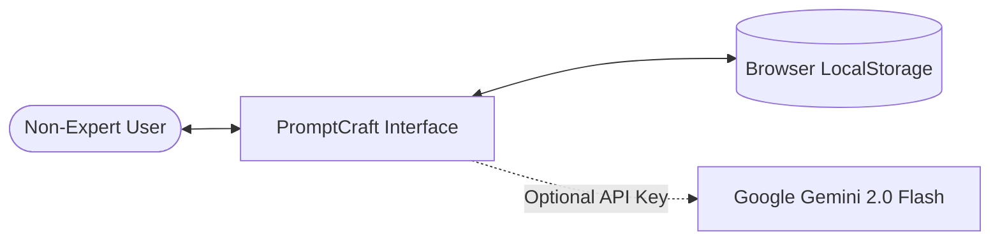

# 📄 Software Requirements Specification (SRS)
## PromptCraft: Human-Centric Prompt Guidance Interface

**Standard:** IEEE Std 830-1998 Compliant  
**Version:** 1.0.0  
**Status:** Approved & Implemented  

---

## 1. Introduction

### 1.1 Purpose
This document provides a complete description of all system specifications, functional requirements, non-functional requirements, and architectural constraints for **PromptCraft**, an interactive prompt-guidance environment designed for non-expert users of Generative AI systems.

### 1.2 Scope of the System
PromptCraft is a client-side Single Page Application (SPA). It provides structured scaffolding for writing prompts, real-time quality heuristics, explainable prompt upgrades, annotated prompt templates, an educational learning hub, and persistent browser history. PromptCraft explicitly does **not** execute prompts against target models, maintaining focus on prompt literacy and interface learnability.

### 1.3 Definitions, Acronyms, and Abbreviations
- **HCI:** Human-Computer Interaction
- **LLM:** Large Language Model
- **XAI:** Explainable Artificial Intelligence
- **SUS:** System Usability Scale
- **ZPD:** Zone of Proximal Development
- **SPA:** Single Page Application
- **HMR:** Hot Module Replacement

---

## 2. Overall Description

### 2.1 Product Perspective
PromptCraft operates as an autonomous, client-side educational workbench. It interfaces optionally with external LLM APIs (Google Gemini) via secure HTTPS requests, while maintaining a fully autonomous, offline heuristic rule engine.

### 2.2 User Characteristics
- **Demographic:** Students, educators, creative writers, non-technical business professionals.
- **Technical Literacy:** Basic familiarity with web browsers and natural language typing; zero prior knowledge of prompt engineering terminology or tokenomics.
- **Pain Points:** Vague outputs from ChatGPT/Claude, frequent hallucinations, cognitive frustration with blank text inputs.

### 2.3 Operating Environment
- Modern standards-compliant web browsers: Chrome 90+, Firefox 88+, Safari 14+, Edge 90+.
- Client architecture: Desktop, tablet, and mobile viewport responsive layouts (320px to 2560px).

---

## 3. Specific Functional Requirements

### 3.1 Module 1: Guided Prompt Builder
- **FR-1.1:** System shall provide domain-specific templates across 7 categories: Writing, Coding, Education, Research, Creative, Business, and Brainstorming.
- **FR-1.2:** System shall implement progressive disclosure allowing users to toggle between **Quick Mode** (3 essential fields) and **Detailed Mode** (all fields).
- **FR-1.3:** System shall dynamically synthesize an engineered prompt in real-time as users input field parameters without requiring a submission click.
- **FR-1.4:** System shall provide inline "Why This Matters" educational tooltips for each input field explaining its impact on model behavior.

### 3.2 Module 2: Explainable Prompt Improver
- **FR-2.1:** System shall accept arbitrary text prompts up to 2,000 characters.
- **FR-2.2:** System shall analyze the prompt and generate an optimized variant with enriched context, personas, and constraints.
- **FR-2.3:** System shall itemize every change made with:
  1. Original text (or missing parameter notice).
  2. Enhanced text.
  3. Educational rationale.
  4. Applied academic design pattern.
- **FR-2.4:** System shall gracefully fall back to deterministic offline heuristics if cloud API connectivity fails or if API keys are unconfigured.

### 3.3 Module 3: Prompt Quality Analyzer
- **FR-3.1:** System shall calculate real-time heuristic scores (0–100) across 5 dimensions: Specificity, Context, Clarity, Structure, and Actionability.
- **FR-3.2:** System shall map composite scores to 4 descriptive proficiency tiers: *Getting Started (0–30)*, *Good Foundation (31–60)*, *Well-Structured (61–80)*, and *Excellent (81–100)*.
- **FR-3.3:** System shall output prioritized, actionable suggestions for improving the prompt.

### 3.4 Module 4: Annotated Prompt Templates
- **FR-4.1:** System shall catalog pre-engineered templates with categorized tags and difficulty badges.
- **FR-4.2:** System shall permit inline customization of all `{variable}` placeholders.
- **FR-4.3:** System shall allow one-click transfer of template parameters into the Guided Builder.

### 3.5 Module 5: Interactive Learning Hub
- **FR-5.1:** System shall provide structured lessons covering Prompt Anatomy, 5 Common Novice Mistakes, 5 Research-Backed Patterns, and 12 Quick Rules.
- **FR-5.2:** System shall provide interactive Before/After toggles comparing naive versus structured prompts with toggleable side-by-side views.

### 3.6 Module 6: Persistence & Export
- **FR-6.1:** System shall persist saved prompts and generated history to HTML5 `localStorage` up to a maximum of 50 items.
- **FR-6.2:** System shall allow users to export history as a formatted `.json` file.
- **FR-6.3:** System shall provide options to delete individual records or purge entire history with user confirmation.

---

## 4. Non-Functional Requirements

### 4.1 Usability & Learnability
- **NFR-1.1:** First-time users shall successfully build an engineered prompt in less than 3 minutes without consulting external documentation.
- **NFR-1.2:** All interactive buttons and inputs shall meet WCAG 2.1 AA accessibility guidelines for color contrast (minimum 4.5:1 ratio).

### 4.2 Performance
- **NFR-2.1:** Client-side prompt assembly and heuristic scoring shall execute in less than 50 milliseconds.
- **NFR-2.2:** The production build bundle shall not exceed 500 kB gzipped to ensure sub-second initial load on 3G mobile connections.

### 4.3 Security & Privacy
- **NFR-3.1:** All user input and prompt history shall remain strictly local to the user's browser; no user prompts shall be stored on any server.
- **NFR-3.2:** If the user supplies an optional Gemini API key, it shall be loaded strictly through client-side environment configurations without public exposure.

### 4.4 Reliability & Robustness
- **NFR-4.1:** The application shall remain 100% functional in offline environments without crashing or displaying blocking modal errors.

