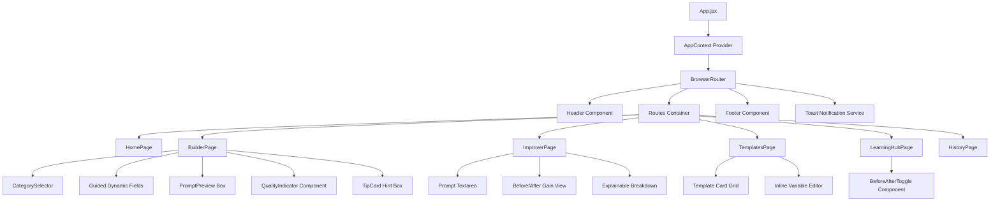
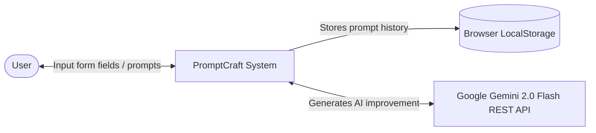
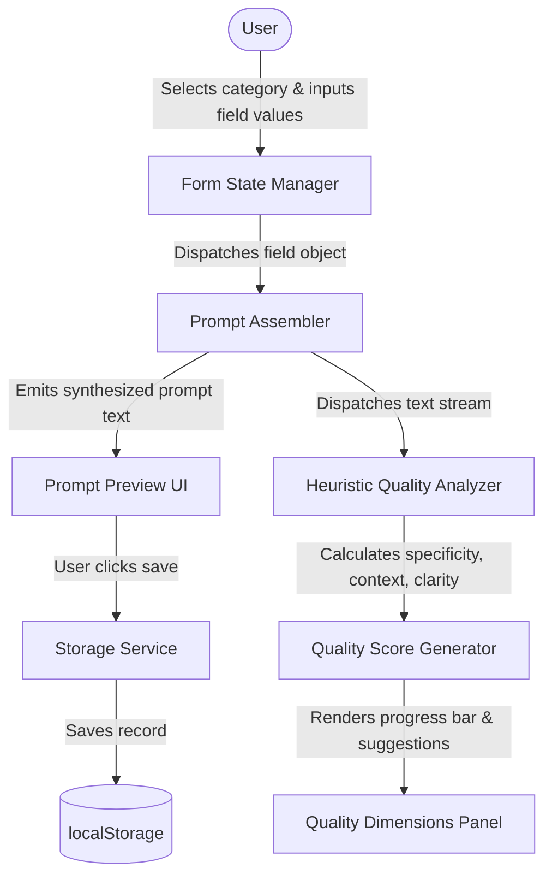

# 🏛️ System Design & Architectural Specification

## 1. Architectural Style & Overview
PromptCraft is constructed as a **modular, client-side Single Page Application (SPA)** utilizing the Model-View-Controller (MVC) pattern adapted for modern component-driven React:

- **Model Layer:** State management handled via React Context (`AppContext`), synchronous browser persistence (`storageService`), and heuristic logic (`ruleEngine`, `promptAssembler`).
- **View Layer:** Declarative UI components styled with Tailwind CSS v4 and Lucide React icons, structured hierarchically from primitive UI elements to full route pages.
- **Controller / Service Layer:** Custom hooks (`usePromptBuilder`, `usePromptAnalysis`, `useAIService`) encapsulating business logic, API orchestration, and debounced event dispatching.

---

## 2. Component Hierarchy Diagram



---

## 3. Data Flow Diagrams (DFD)

### Level 0 DFD (Context Diagram)


### Level 1 DFD (Builder & Analyzer Flow)


---

## 4. Database & Storage Schema

PromptCraft requires no server-side SQL/NoSQL database; all persistence is executed client-side via browser `localStorage` under isolated key namespaces:

### Storage Schema Definition

#### `promptcraft_history` (Array of JSON Objects)
```typescript
interface HistoryEntry {
  id: string;              // Unique alphanumeric identifier (e.g. "m2x8a9bf3")
  timestamp: string;       // ISO 8601 formatted datetime string
  source: "Builder" | "Improver"; // Originating module
  category?: string;       // Chosen domain category (e.g. "writing", "coding")
  prompt: string;          // Assembled or improved prompt string
  originalPrompt?: string; // Original prompt if generated via Improver
  score: number;           // Calculated quality score (0 - 100)
}
```

#### `promptcraft_preferences` (JSON Object)
```typescript
interface UserPreferences {
  theme: "light" | "dark";
  detailedModeDefault: boolean;
  lastActiveCategory: string;
}
```

---

## 5. Algorithmic Specifications

### 5.1 Heuristic Quality Scoring Algorithm
The overall prompt quality score $Q \in [0, 100]$ is computed as a weighted sum of five orthogonal dimensions:

$$Q = 0.25 \cdot S_{\text{specificity}} + 0.20 \cdot C_{\text{context}} + 0.25 \cdot L_{\text{clarity}} + 0.15 \cdot T_{\text{structure}} + 0.15 \cdot A_{\text{actionability}}$$

Where:
- **$S_{\text{specificity}}$**: Evaluated based on word count thresholds, numeric digit presence, quote presence, and specific domain qualifier tokens.
- **$C_{\text{context}}$**: Evaluated through logical causal indicators (`because`, `given that`, `considering`), sentence count (>2), and persona framing (`target`, `audience`).
- **$L_{\text{clarity}}$**: Evaluated by the presence of imperative action verbs (`write`, `analyze`, `compare`), punctuation termination, and absence of epistemic hesitation (`maybe`, `kind of`, `idk`).
- **$T_{\text{structure}}$**: Evaluated by delimiter formatting (colons, linebreaks, numbered steps) and explicit output format requests (`table`, `bullet points`, `JSON`).
- **$A_{\text{actionability}}$**: Evaluated by lead verb positioning within the initial 3 tokens and clearly defined output deliverables.

---

## 6. Security & Privacy Architecture
1. **Zero Server Footprint:** No intermediary backend server receives user prompts. Prompts never leave the local browser unless explicitly routed to the user's configured Gemini API endpoint.
2. **Safe Credential Handling:** External API keys are read strictly through client-side environment variables prefixed with `VITE_`. No keys are hardcoded into production repository commits.
3. **Cross-Site Scripting (XSS) Prevention:** React automatically escapes all dynamic content rendered in JSX elements, preventing arbitrary HTML injection.

